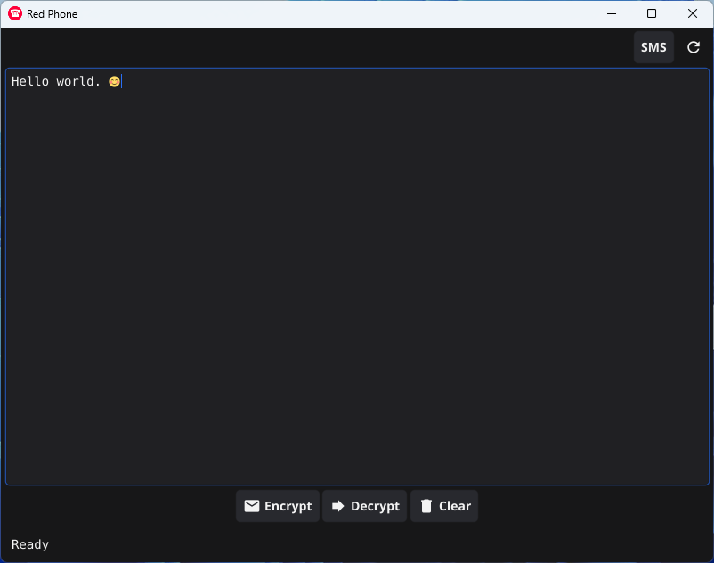
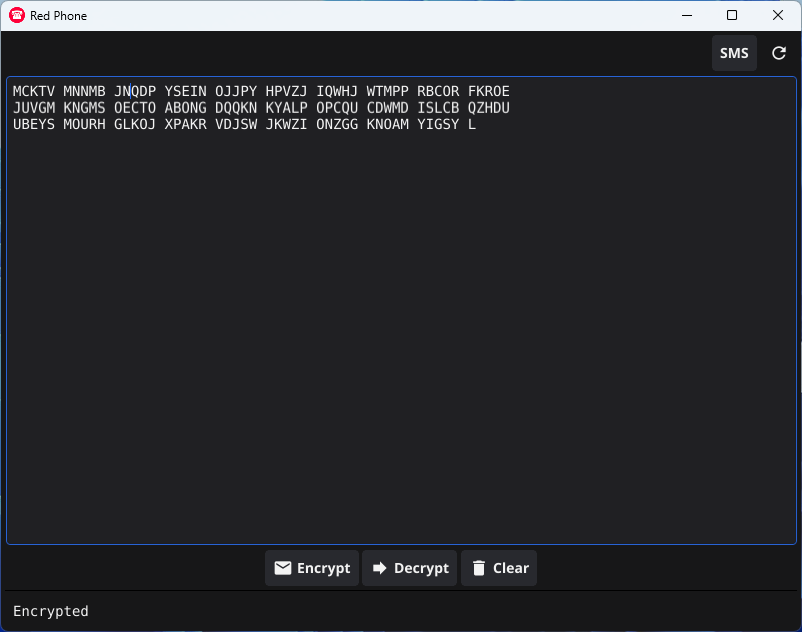
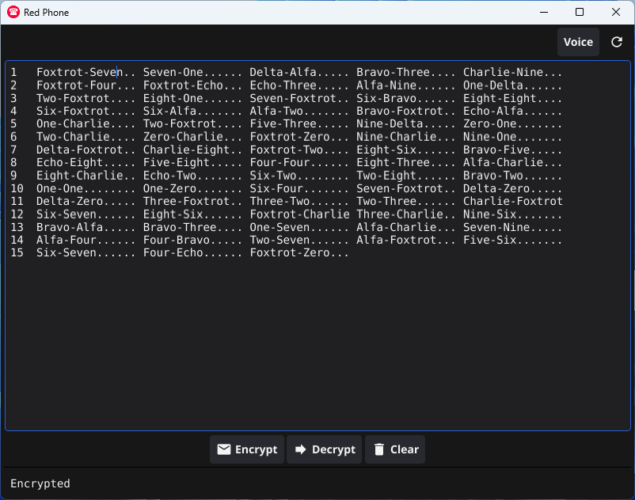
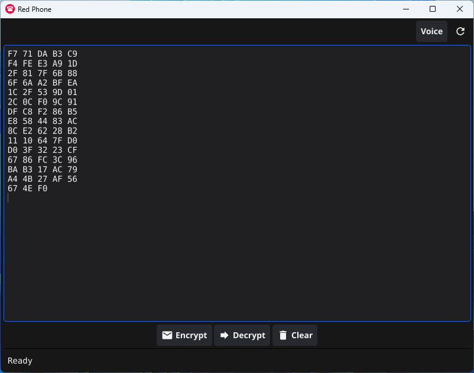
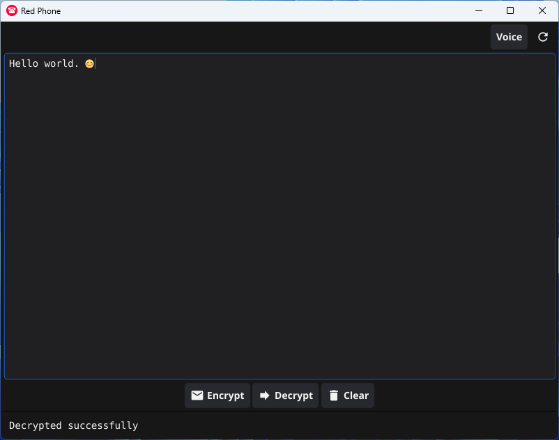

# Red Phone
📞 Red Phone is a minimalist encryption tool designed for voice and SMS transmission.  

It uses ChaCha20 with a 32 bytes hex key and a 12 bytes hex nonce.  
For nonce creation, I recommend my [nora](https://github.com/Ch1ffr3punk/nora) program.  







If you like Red Phone consider a small donation in crypto currencies or buy me a coffee.
```
BTC: bc1qm0e7r94ht60tu7zuewf0ftl3td0xc700rvcagn
Nym: n1f0r6zzu5hgh4rprk2v2gqcyr0f5fr84zv69d3x          
```
<a href="https://www.buymeacoffee.com/Ch1ffr3punk" target="_blank"></a>

Red Phone is dedicated to Alice and Bob.
